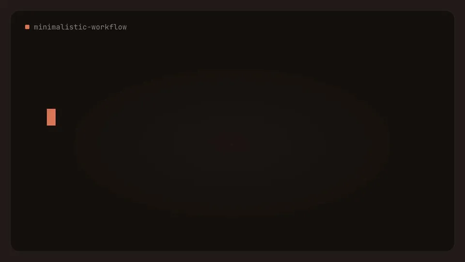
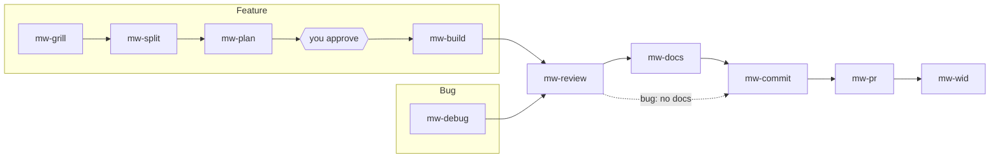

<div align="center">

# Minimalistic Workflow

**Each skill does one thing. You approve the plan; the agent ships.**




</div>

A small set of Claude Code skills for shipping features and fixing bugs end to end. The human approves the plan; the agent implements, verifies and documents.

## Quick start

```bash
git clone https://github.com/NowackiKuba/minimalistic-workflow.git ~/minimalistic-workflow
cp -r ~/minimalistic-workflow/skills/* ~/.claude/skills/
ln -sfn ~/minimalistic-workflow/bin/* ~/.local/bin/

cd your-project && mw-init   # keep tickets/ and .mw/ out of git
```

Then in Claude Code: `/mw-design` once per project, `/mw-grill` to start a feature, `/mw-debug` for a bug. Full setup: [Install](#install).

## Flows

**Once per project:** `mw-design` before the first feature



**Feature:** `mw-grill` → `mw-split` → `mw-plan` → `mw-build` → `mw-review` → `mw-docs` → `mw-commit` → `mw-pr` → `mw-wid`

**Bug:** `mw-debug` → `mw-review` → `mw-commit` → `mw-pr` → `mw-wid`

| Skill | Does |
|---|---|
| `mw-design` | Grills the visual design system, writes `docs/DESIGN.md` and design tokens |
| `mw-grill` | Reads docs and code, asks questions until the feature is unambiguous, writes a summary |
| `mw-split` | Turns a grill summary into local tickets in `tickets/` |
| `mw-plan` | Turns a ticket into a plan and stops for approval |
| `mw-build` | Implements the approved plan with a test/typecheck/lint loop |
| `mw-debug` | Reproduces a bug with a failing test, then fixes it |
| `mw-review` | Reviews the diff against the ticket, plan and conventions |
| `mw-docs` | Updates docs the change made stale |
| `mw-commit` | Small, logical conventional commits |
| `mw-pr` | PR description from the project's PR template |
| `mw-wid` | Short "what I did" note in your Obsidian vault, one folder per project |

Every skill runs only when you invoke it (`/mw-*`); none triggers on its own.

`mw-grill`, `mw-plan`, `mw-debug` and `mw-review` run on opus; `mw-build` runs on sonnet. If build `attempts` or `stopped` results rise noticeably, switch mw-build back to opus.

## Core principle

The user produces the first version of every decision (scope, split, plan, hypothesis, review findings). The AI critiques it, asks questions and executes. The AI never presents its own full solution first. It may reveal its own version only after the user's version exists, or when the user explicitly asks for it.

## Think mode vs ship mode

`mw-grill`, `mw-plan` and `mw-debug` start by proposing a mode with a one-sentence reason, unless you already said or the ticket records one. Reply `ok` to accept, or `think` / `ship` to override. The mode is recorded in the grill summary, ticket, plan and debug report, so later steps follow it.

They propose **think** when the change touches a [sensitive area](#sensitive-areas), touches paths you have not changed in the last ~3 months (`git log --author`), or involves a design decision that is hard to reverse. Otherwise they propose **ship**.

```
Proposed mode: think — touches migrations and queue retries. OK?
```

| | **think** | **ship** |
|---|---|---|
| `mw-grill` | You write goal, scope, out of scope, edge cases, risks; the AI asks only about gaps | The AI drives the questions |
| `mw-split` | You propose the split; the AI critiques it | The AI proposes the split |
| `mw-plan` | You write the plan; the AI reviews it, then offers its own version for comparison | The AI writes the plan |
| `mw-build` | Builds only what the plan specifies, stops on open design decisions, ends with a comprehension check | Builds the plan |
| `mw-debug` | You give the hypothesis and the fix; the AI hints in steps and critiques | The AI finds the cause and proposes the fix |
| `mw-review` | You list your findings first; output is You found / You missed / False alarms | Blockers / Suggestions |

In both modes you approve before anything is written, and a plan section marked `[human]` is left for you to implement.

## Sensitive areas

The single definition. `mw-review` uses it to pick review size L; `mw-grill`, `mw-plan` and `mw-debug` use it to propose think mode.

- auth/permissions
- payments
- migrations or schema
- public API contracts
- security config
- infra/deploy
- queues/jobs with retries
- cryptography
- PII handling

## Manual verification

`mw-split` adds an optional `## How to verify` section to tickets with user-facing behaviour: manual steps to check the change in the UI or API. Before running reviewers, `mw-review` asks whether you did them, and lists them if not. This can later be automated with agent-browser.

## Files the workflow uses

<details>
<summary>Paths</summary>

```
CLAUDE.md                 # project map: docs, commands (see templates/CLAUDE.md)
tickets/NNN-slug.md       # local tickets (mw-split)
.mw/grill/<slug>.md       # grill summaries (mw-grill)
.mw/plans/NNN-slug.md     # approved plans (mw-plan)
.mw/metrics.jsonl         # one line per step, for measuring the workflow (local only)
```

</details>

## Install

```bash
git clone <repo-url> ~/minimalistic-workflow
cp -r ~/minimalistic-workflow/skills/* ~/.claude/skills/
```

Put the scripts in `bin/` on your PATH (`~/.local/bin` must be on PATH):

```bash
chmod +x ~/minimalistic-workflow/bin/*
ln -sfn ~/minimalistic-workflow/bin/* ~/.local/bin/
```

Then add the sections from `templates/CLAUDE.md` to your project's `CLAUDE.md`, and run `mw-init` in the project root.

<details>
<summary><b>Scripts</b>: mw-init, mw-run, mw-stats</summary>

| Script | Does |
|---|---|
| `mw-init [--commit-plans]` | Adds `tickets/` and `.mw/` to `.git/info/exclude` (local, never committed), so workflow files stay out of team repos. `--commit-plans` keeps `.mw/plans/` committable, for your own repos where you want plan history. |
| `mw-run <test\|typecheck\|lint> -- <command...>` | Runs a check with compact output: `ok (<kind>)` on success; on failure the last 40 lines (test) or the first 20 error lines plus an error count (typecheck, lint). Exits with the command's exit code. The skills run every check through it. |
| `mw-stats [weeks=4]` | Weekly summary of `.mw/metrics.jsonl` in the current project, answering the three questions below. Needs `jq`. |

</details>

## Metrics

<details>
<summary>What gets logged and why</summary>

`grill`, `plan`, `build`, `debug` and `review` each append one line to `.mw/metrics.jsonl`. The metrics answer exactly three questions; a field that answers none of them is not logged.

| Question | Fields |
|---|---|
| 1. Are my plans getting better? | plan `revisions`; build `deviations`, `attempts`, `result` (`stopped`) |
| 2. Am I catching more in review? | review `user_found` vs `user_missed` (think mode) |
| 3. Do I actually use think mode, and is it worth it? | `mode` on every line: think/ship ratio, and review `blockers` and build stops per mode |

</details>

## Principles

1. Fixed context lives in docs and skills; the task prompt carries only what is unique.
2. A human approves the plan before code is written. Fixing a plan is cheaper than fixing code.
3. Nothing is "done" while tests, typecheck or lint are red.
4. Review happens in a fresh session, so the reviewer does not share the author's assumptions.
5. The steps that matter log one metrics line, so you can tell whether the workflow actually helps (`mw-stats`). `.mw/metrics.jsonl` stays local: `mw-init` excludes it, and the steps that log metrics remind you to run it when the file is not ignored.
